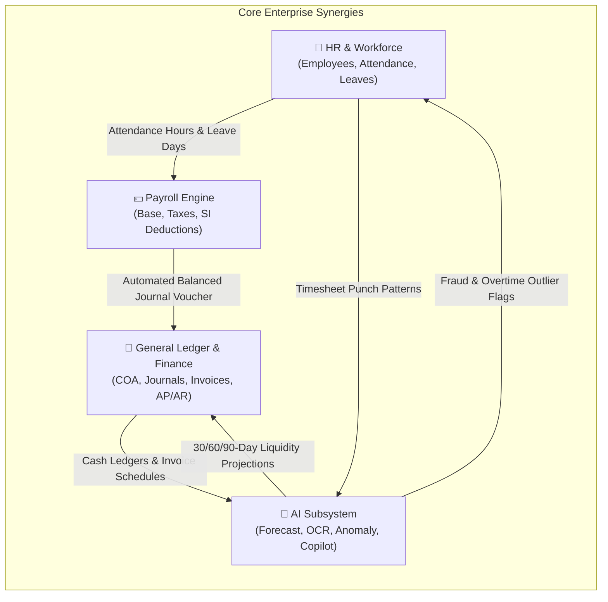

<div align="center">

# 🏢 Indigo ERP with AI
### System Analysis & Design Specification (SAD / SDD) & Full-Stack Platform
**Next-Generation Accounting, Human Resources & AI-Powered Enterprise Resource Planning Platform**

<br />

[](https://github.com/Saifahmed3993/ERP-System-with-AI)
[](https://github.com/Saifahmed3993/ERP-System-with-AI)
[](https://github.com/Saifahmed3993/ERP-System-with-AI)
[](https://github.com/Saifahmed3993/ERP-System-with-AI)
[](https://github.com/Saifahmed3993/ERP-System-with-AI)
[](https://github.com/Saifahmed3993/ERP-System-with-AI)
[](https://github.com/Saifahmed3993/ERP-System-with-AI)
[](https://github.com/Saifahmed3993/ERP-System-with-AI)

<br />

**A state-of-the-art, academic and enterprise-grade System Analysis and Design specification and running platform for a comprehensive Accounting & HR ERP system augmented by predictive machine learning.**

*Designed with Egyptian statutory tax compliance (14% VAT), Egyptian Labor Law (Law No. 12 of 2003), Egyptian banking integration (CIB, NBE, Banque Misr), and predictive artificial intelligence.*

</div>

---

## 📖 Executive Summary & Repository Purpose

This repository houses the complete, authoritative **System Analysis and Design (SAD / SDD)** documentation, architectural blueprints, and full source code for **Indigo ERP with AI**.

Traditional enterprise software isolates human resource management from financial accounting, forcing organizations to rely on manual spreadsheets, paper memos, and error-prone double-entry bookkeeping. This platform addresses this critical gap by delivering:
1. **The Pivotal HR-to-Finance Bridge:** Approving a monthly payroll cycle instantly calculates progressive Egyptian income taxes and social insurance, generating atomic, balanced General Ledger journal vouchers ($\sum \text{Debit} == \sum \text{Credit}$) without human transcription.
2. **Predictive AI Intelligence:** Integrates machine learning directly into operations — forecasting 30/60/90-day cash flow liquidity, parsing scanned vendor invoices via computer vision OCR, and guarding timesheets with statistical anomaly detection.
3. **Full Egyptian Regulatory Compliance:** Natively implements the **14% Egyptian VAT**, electronic invoicing QR codes, withholding taxes, and labor law leave and overtime rules.



---

## 🚀 التشغيل السريع (Quick Start)

### المتطلبات الأساسية
- Node.js 18+ و npm.
- .NET SDK 10.
- SQL Server محلي أو خادم SQL سحابي.

### تشغيل التطوير المحلي

```powershell
# الطرفية الأولى: تشغيل الـ API
cd backend/src/IndigoERP.API
dotnet restore
dotnet run
```

```powershell
# الطرفية الثانية: تشغيل واجهة React
npm install
npm run dev
```

* واجهة المستخدم تعمل افتراضياً على: `http://localhost:5173`
* واجهة الـ API تعمل على: `http://localhost:5250` (أو المعرّف في `launchSettings.json`) مع Swagger على `/swagger`.

---

## 🔐 Default Enterprise Test Accounts (حسابات الدخول التجريبية)

| Role | Name | Email | Password | Scope of Authority |
|:---|:---|:---|:---|:---|
| **🛡️ Administrator** | Saif AlDin Ahmed | `admin@indigo.co` | `Admin@123456` | Full administrative control & settings |
| **👁️ Viewer (مشاهد فقط)** | Viewer User | `viewer@indigo.co` | `Viewer@123456` | **Read-only access across all modules (مشاهد فقط)** |
| **👥 HR Director** | Ahmed Mansour | `hr@indigo.co` | `Hr@123456` | Workforce, Attendance, Leave & Payroll |
| **💰 Finance Director** | Tarek El-Sayed | `finance@indigo.co` | `Finance@123456` | Financial statements, Invoicing, Tax & AI |
| **📒 Senior Accountant**| Mariam Shenouda | `accountant@indigo.co` | `Accountant@123456` | General Ledger, Journals, AP/AR & Bills |

---

## 🌐 النشر المجاني 100% (100% Free Deployment)

تم تضمين ملفات التجهيز للنشر السحابي المجاني:
* **Frontend:** النشر على **[Vercel](https://vercel.com/)** مجاناً مع ملف التوجيه المرفق [vercel.json](vercel.json).
* **Backend:** النشر على **[MonsterASP.NET](https://www.monsterasp.net/)** (استضافة ASP.NET Core مجانية + قاعدة بيانات MS SQL Server مجانية حتى 1GB)، أو على **[Render.com](https://render.com/)** عبر الـ [Dockerfile](Dockerfile).
* الدليل الكامل متاح في [DEPLOYMENT.md](DEPLOYMENT.md).

---

## 📚 Complete Technical Documentation Directory

The complete System Analysis & Design specification is organized into **10 comprehensive engineering volumes** plus a master unified specification:

| Volume | Document Name | Description & Core Highlights | Direct Link |
|:---:|:---|:---|:---:|
| 📘 **Master** | **System Analysis & Design Master** | The unified 360-degree specification consolidating all analytical, architectural, and design findings. | [`SYSTEM_ANALYSIS_AND_DESIGN.md`](./docs/SYSTEM_ANALYSIS_AND_DESIGN.md) |
| 📋 **Vol. 01** | **System Analysis Document (SAD)** | As-Is vs. To-Be comparative analysis, TELOS feasibility study, user personas, comprehensive functional requirements (FR-HR, FR-PAY, FR-FIN, FR-AI), NFRs, and Requirements Traceability Matrix (RTM). | [`01_SYSTEM_ANALYSIS.md`](./docs/01_SYSTEM_ANALYSIS.md) |
| 🔄 **Vol. 02** | **Process Modeling & Data Flow Diagrams** | Environmental Context Diagram, DFD Level 0 System Decomposition, DFD Level 1 Subsystem workflows (HR, Payroll, Finance, AI Subsystem). | [`02_PROCESS_MODELING_DFD.md`](./docs/02_PROCESS_MODELING_DFD.md) |
| 🎯 **Vol. 03** | **Use Case Specifications** | Master system use case diagram, 10 fully-dressed use cases with primary actors, preconditions, postconditions, sunny/rainy day flows. | [`03_USE_CASE_SPECIFICATIONS.md`](./docs/03_USE_CASE_SPECIFICATIONS.md) |
| 🏛️ **Vol. 04** | **System Architecture Document** | 4+1 Architectural View Model, technology radar, clean modular monolith decomposition, horizontal scalability, container orchestration. | [`04_SYSTEM_ARCHITECTURE.md`](./docs/04_SYSTEM_ARCHITECTURE.md) |
| 💾 **Vol. 05** | **Database Design & ERD** | Conceptual, logical, and physical data models, 3NF normalization proofs, comprehensive data dictionary, SQL Server indexes. | [`05_DATABASE_DESIGN_ERD.md`](./docs/05_DATABASE_DESIGN_ERD.md) |
| ⚡ **Vol. 06** | **UML Sequence & State Diagrams** | Sequence interactions (Payroll Cycle, Invoice Settlement, Cash Forecast) and state transition lifecycles. | [`06_UML_SEQUENCE_AND_STATE_DIAGRAMS.md`](./docs/06_UML_SEQUENCE_AND_STATE_DIAGRAMS.md) |
| 🧠 **Vol. 07** | **AI Intelligence Modules Specification** | Predictive architecture: Prophet 90-day cash flow forecaster, LayoutLMv3 document OCR parser, isolation forest anomaly detector. | [`07_AI_INTELLIGENCE_MODULES.md`](./docs/07_AI_INTELLIGENCE_MODULES.md) |
| 🔌 **Vol. 08** | **RESTful API Specification** | Production API contract, OpenAPI 3.0 schema, authentication envelopes, error schemas, and response patterns. | [`08_REST_API_SPECIFICATION.md`](./docs/08_REST_API_SPECIFICATION.md) |
| 🔒 **Vol. 09** | **Security & Compliance Framework** | NIST SP 800-53 security controls, PBKDF2/bcrypt hashing, immutable audit logging, GDPR & Egyptian Data Protection Law compliance. | [`09_SECURITY_AND_COMPLIANCE.md`](./docs/09_SECURITY_AND_COMPLIANCE.md) |
| 🎨 **Vol. 10** | **UI/UX Design Specification** | Enterprise design system tokens, typography scales, light/dark themes, accessibility (WCAG 2.1 AA), and responsiveness. | [`10_UI_UX_DESIGN_SPECIFICATION.md`](./docs/10_UI_UX_DESIGN_SPECIFICATION.md) |

---

## 🛠️ Technology Stack Breakdown

| Architectural Layer | Technologies Employed |
|:---|:---|
| **Frontend SPA** | React 19, TypeScript, Vite 6, React Router 7, Bootstrap Icons |
| **Styling & Theming** | Custom CSS Design System with CSS Variables, Dark/Light Themes |
| **Backend API** | ASP.NET Core 10 Web API, C# 13, RESTful JSON Architecture |
| **Data Access & ORM** | Entity Framework Core 10 (Code-First, Migrations, Interceptors) |
| **Database** | Microsoft SQL Server 2022+ / Azure SQL Database |
| **Security & Auth** | ASP.NET Core Identity, JWT Bearer Tokens, RBAC Claims |
| **AI Subsystem** | Python 3.12, FastAPI, ONNX Runtime, Prophet, LayoutLMv3, Scikit-Learn |
| **Deployment** | Vercel (Frontend), MonsterASP / Render Docker (Backend) |
| **Testing & Quality** | Playwright E2E Suite, xUnit, Automated Integration Checks |
| **Version Control** | Git + GitHub |

---

## 📄 License & Attribution

This project is published under the [MIT License](LICENSE).  
Developed for academic excellence and enterprise deployment at **Enterprise ERP System**.

---

<div align="center">

**[Saifahmed3993/ERP-System-with-AI](https://github.com/Saifahmed3993/ERP-System-with-AI)**  
*Building 12B, Smart Village, KM 28 Cairo-Alex Desert Road, Giza, Egypt*  
© 2026 Enterprise ERP with AI. All rights reserved.

</div>
